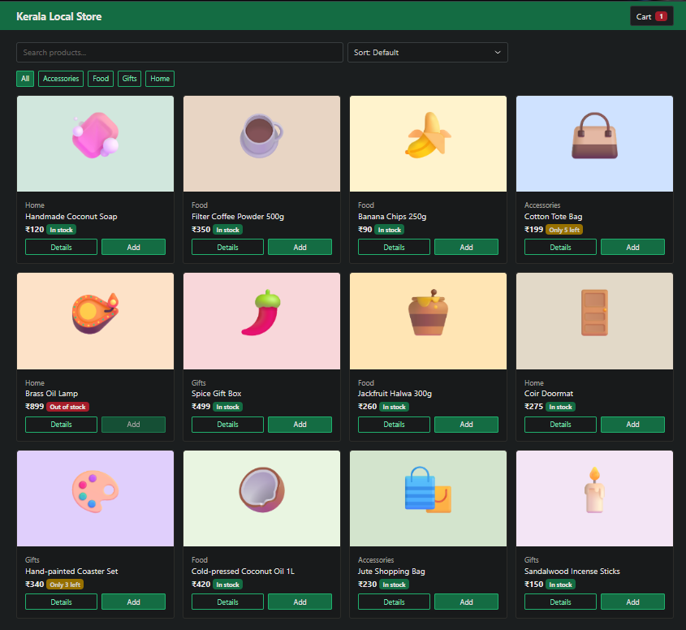
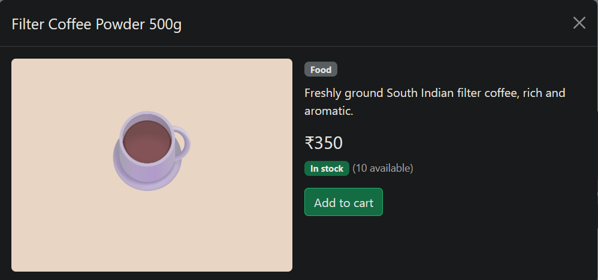
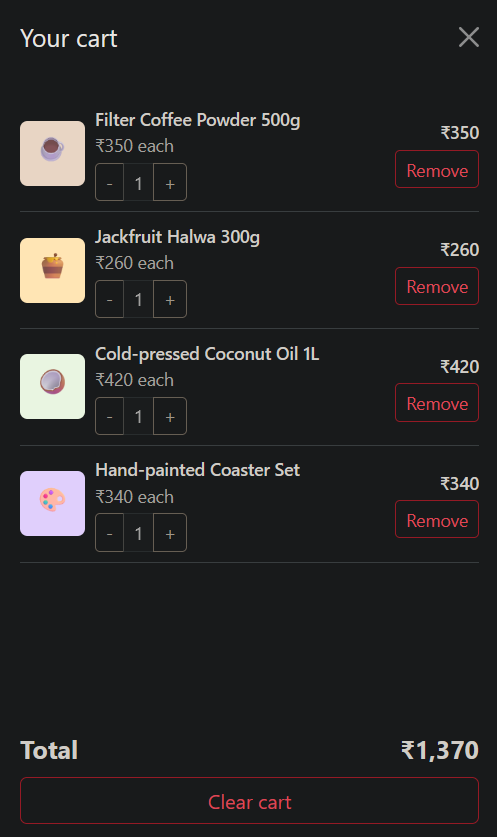
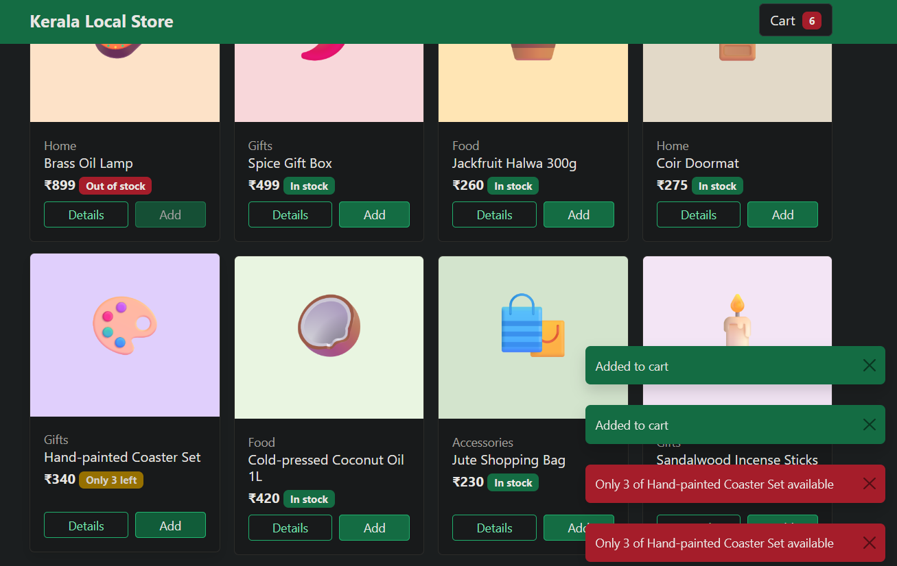
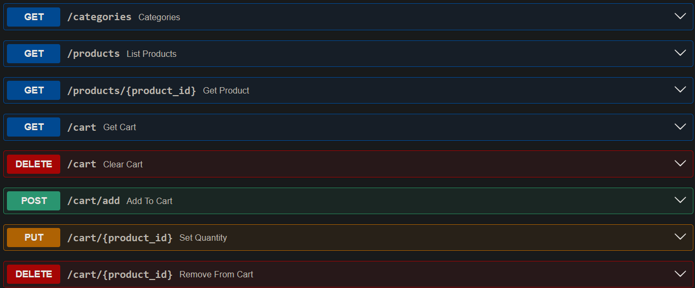

# Kerala Local Store

E-commerce demo built with FastAPI, SQLite and Bootstrap. It has a product listing with search, category filter and sorting, a product detail view, and a server-side shopping cart that persists per browser session.

## Setup
```bash
python -m venv venv
venv\Scripts\activate
pip install -r requirements.txt
uvicorn main:app --reload
```
Open http://127.0.0.1:8000 (the store) or http://127.0.0.1:8000/docs (the API).

## API
Cart routes need the header `X-Session-Id` (8 to 64 characters). The web page generates it automatically and keeps it in localStorage.

| Method | Route | Description |
|---|---|---|
| GET | /products | List products (`?search=`, `?category=`, `?sort=price_asc`, `price_desc` or `name`) |
| GET | /products/{id} | Product detail |
| GET | /categories | List categories |
| GET | /cart | View cart |
| POST | /cart/add | Add to cart, body `{"product_id":1,"quantity":1}` |
| PUT | /cart/{product_id} | Set quantity, body `{"quantity":2}` |
| DELETE | /cart/{product_id} | Remove one item |
| DELETE | /cart | Clear the cart |

## Sample data
12 products across Food, Home, Accessories and Gifts are created automatically on first run. Each product has an image, price, description and stock level. Example:
```json
{"id":1,"name":"Handmade Coconut Soap","category":"Home","price":120,"stock":25,"in_stock":true}
```

## Validation and user feedback
- Quantity must be between 1 and 99
- Out-of-stock products cannot be added to the cart
- Adding more than the available stock is rejected with a clear message
- Every cart action shows a message (added, removed, cleared or error)
- Status codes: 200, 201, 400, 404, 422

## Screenshots




